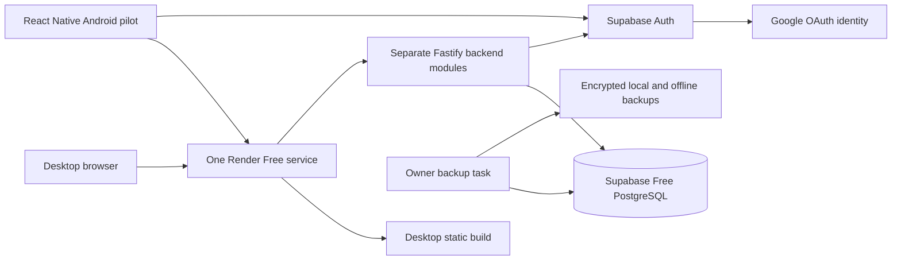

# DailyLoop — free-tier technology stack and HLD

29 October 2026. Revised to follow the owner’s instruction: **free tiers only until initial customer traction; no paid upgrades, paid trials or pay-as-you-go services without later explicit authorization.** This supersedes the earlier paid-capable hosting baseline. No services have been provisioned by this document.

## 1. Selected stack

| Area | Free baseline | Important boundary |
|---|---|---|
| Mobile | TypeScript, React Native, Expo SDK 58, Expo Router | Native Android/iOS source stays in mobile/ |
| Desktop | React, TypeScript, Vite, React Router | Source stays in desktop/; hosted static files served by the API service initially |
| API | Node 24, Fastify, Zod, Drizzle + pg | Separate backend/ source and tests; one hosted service |
| Database/identity | Supabase Free PostgreSQL + Auth | One initial cloud pilot project; second free project only if account quota permits |
| Login | Supabase Google OAuth, basic identity scopes | Recommended no-SMTP pilot default; Google OAuth client/consent setup required; no paid Google Cloud compute |
| Forms/cache | React Hook Form, TanStack Query, shared Zod contracts | Free open-source libraries |
| Native session/cache | SecureStore, protected SQLite outbox, NetInfo | Expo-compatible versions; real native build verification required |
| Native files | expo-print/sharing/file-system as needed | No paid export service; API streams generated PDFs/CSV |
| Hosting | One Render Free Web Service | Serves desktop static build + /v1 API from same HTTPS onrender.com origin |
| Source/CI | GitHub Free private repo; included Actions allowance | Standard runners only, spending disabled; local fallback at quota |
| Build | Local Android builds; Expo EAS Free when allowance available | Wait or build locally when quota ends; no paid queue/build credits |
| Design | Existing local brand assets, Figma Free within available limits | No upgrade required; record design verification gaps |
| Backups | Encrypted local exports and a second owner-controlled offline copy | Daily operational task, restore rehearsal; not managed daily backups/PITR |
| Operations | Render/Supabase dashboards, redacted logs and manual checks | Paid monitoring/log drains/cron are not prerequisites |

Do not require Vercel, Resend, Sentry, Better Stack, R2, a purchased domain, paid Render, Supabase Pro or developer-store enrollment to run the free pilot. Optional free services are not automatically introduced; verify their account limits and hard spending controls before adding them.

Vercel Hobby is excluded because its published terms limit it to non-commercial personal use. Render’s own documentation says Free instances are not recommended for production: this plan therefore targets a limited early-access pilot with disclosed availability limitations, not a promised always-on service.

## 2. High-level flow

Source separation remains unchanged even though frontend artifacts and API share a host. Host serves /v1 and /auth before static assets; SPA fallback never swallows API errors. Both browser and API use the same provider HTTPS origin, so host-only HttpOnly cookies work without buying a domain or relying on third-party cookies. Mobile uses the same API URL with bearer sessions.

## 3. Authentication and security

Use Google login through Supabase for the free pilot, avoiding a paid-domain/SMTP dependency. Only basic identity scopes are requested; no Gmail, Drive or other customer account access. Configure each Supabase callback, Google consent-screen audience and exact application redirect. Test actual external pilot accounts; a consent screen left in Testing may limit who can sign in. If a target owner lacks a suitable Google account, resolve a verified free email-delivery alternative before onboarding them; do not disable verification or quietly depend on restricted built-in SMTP.

Web: backend-managed OAuth PKCE/state callback; opaque Secure/HttpOnly/host-only SameSite=Lax application cookie. Mobile: system browser/Supabase OAuth PKCE and environment-specific native callback, secure session adapter. Application session revocation and membership checks remain required. Google-only login is a pilot recommendation, not a claim it is already implemented. Review Apple sign-in requirements before a later iOS App Store release.

All business writes go through the API. Verify JWT issuer/signature/audience/expiry and active app session. Use owner membership authorization, tenant-scoped composite foreign keys, restricted runtime DB role and tested PostgreSQL RLS. Never use privileged Supabase keys in the client. Secure access, idempotent writes, correction history and data isolation are not deferred to save money.

## 4. Environments

- Local: Supabase CLI/Docker or local PostgreSQL fixtures, API localhost:4000, desktop localhost:5173, native simulators/emulators. Pure domain work does not require cloud accounts.
- Cloud pilot: one Supabase Free project and one Render Free service. Staging uses local/test fixtures initially. An isolated second Supabase Free project can be used if the account’s two-active-project quota is available; no extra paid project.
- Hosted staging API is optional and shares Render workspace free-hour limits; do not assume two always-running services fit one allowance. No staging data in the pilot tenant/database.
- Browser paths are relative to the same Render origin. EXPO_PUBLIC_API_URL uses its HTTPS URL. No domain purchase, DNS plan or email sender domain is required for this default.

Build contracts, backend and desktop from the monorepo. Host compiled backend on PORT/0.0.0.0; serve desktop/dist. No database, exports or customer files may rely on Render’s ephemeral filesystem. Production-like migrations and compatibility with older native clients still apply.

## 5. Free-tier limits checked on 29 October 2026

- Supabase Free: published allowances include 500 MB database, 1 GB storage, 50,000 MAU, 5 GB egress and 5 GB cached egress, and at most two active free projects. Confirm quota allocation in the owner dashboard; these are not guarantees of application capacity. Low activity over a week can cause project pausing.
- Render Free: published allowance is 750 instance-hours per workspace/month. Idle services spin down after 15 minutes; the next start can take about a minute. Restarts/redeploys/spin-down lose local files. Free Render Postgres expires after 30 days and is not selected; use Supabase instead. Monitor bandwidth/build/egress limits too.
- EAS Free currently lists 15 Android and 15 iOS builds with low-priority queues. Store signing/distribution requirements still apply; cloud build inclusion does not make App Store membership free.
- GitHub Actions free usage is bounded by account allowance and artifact/cache limits. Keep spend disabled, clean retained artifacts and use local tools when limits are reached.

No synthetic keep-alive traffic to defeat provider inactivity limits. Show a truthful “Starting the server…” state with bounded retries on cold-start/network failures; never create a fresh financial operation ID on retry. No always-on SLA or guaranteed recovery time is promised on free infrastructure.

## 6. Recovery and operations

Stream exports on demand rather than retaining customer statements in paid object storage. Supabase Storage is optional only within its free allocation; keep buckets private if enabled.

Before accepting real records, implement an owner-run encrypted daily database export, a separate offline copy, backup-age checks and a demonstrated restore including identity mapping and session reset. Back up retained object bytes separately if introduced. Store decryption material separately from backup files and never commit backups to GitHub. Provider-free backups cannot be assumed to include PITR/daily managed restore.

RPO ≤24 hours remains a manual operational target only if daily backups are actually completed. Do not claim the former four-hour guaranteed recovery/always-on behavior. If backups fail or the operator cannot maintain the routine, pause new customer onboarding until resolved.

Use redacted errors and provider dashboards first. Any future scheduled backup/erasure automation must stay within a verified free allowance; manual runbooks are the initial fallback. Process deletion requests on a documented operator schedule and test the process before the pilot; no paid cron job dependency.

## 7. Rollout and upgrade policy

Initial working target: a small early-access cohort, approximately 3–5 business owners, web access and Android test APKs. Those are operating targets, not platform limits. Continue iOS development/simulator testing; public App Store/TestFlight distribution is deferred pending Apple membership authorization. Google Play enrollment/publication is approved for spending and proceeds after MVP/testing/signing gates pass. Confirm any applicable Android off-store developer-verification requirements before external APK distribution; do not assume sideloading removes all platform obligations.

Review capacity at 70% of any free quota, repeated cold-start disruption, backup burden or the first 10 active businesses—whichever occurs first. Owner accounts/MAU and delivery customers are different metrics: a few owners may maintain thousands of records. Upgrade decisions depend on actual database/traffic/build use and reliability needs, not just registered-user count.

No automatic upgrades, trials, paid build credits, overage spending or card-required resources. Reaching a cap means reduce usage, run locally, wait for allowance reset or ask the owner about a paid option. Paid migration later can retain Supabase/PostgreSQL and Node architecture; separate desktop hosting, managed backups, SMTP/domain and store publication can be introduced then.

## 8. Official references

- https://supabase.com/pricing
- https://supabase.com/docs/guides/platform/free-project-pausing
- https://supabase.com/docs/guides/auth/social-sign-in/auth-google
- https://render.com/docs/free
- https://vercel.com/docs/plans/hobby
- https://expo.dev/pricing
- https://docs.github.com/en/billing/concepts/product-billing/github-actions
- https://developer.apple.com/help/account/basics/about-your-developer-account
- https://support.google.com/googleplay/android-developer/answer/6112435

## Latest budget and implementation clarification

The owner authorizes paying for Google Play enrollment/publication. Other infrastructure remains free-tier-first; paid-tier upgrades are designed to preserve data, identities and API contracts, and require a later explicit spending decision. Public Android store release is therefore in scope once product and Play testing gates pass, not deferred solely because of enrollment cost. No Apple membership purchase or unrelated paid service is authorized. See SUPABASE_SETUP.md, IMPLEMENTATION_STATUS.md and UPGRADE_PATH.md for the current code increment and upgrade steps.
